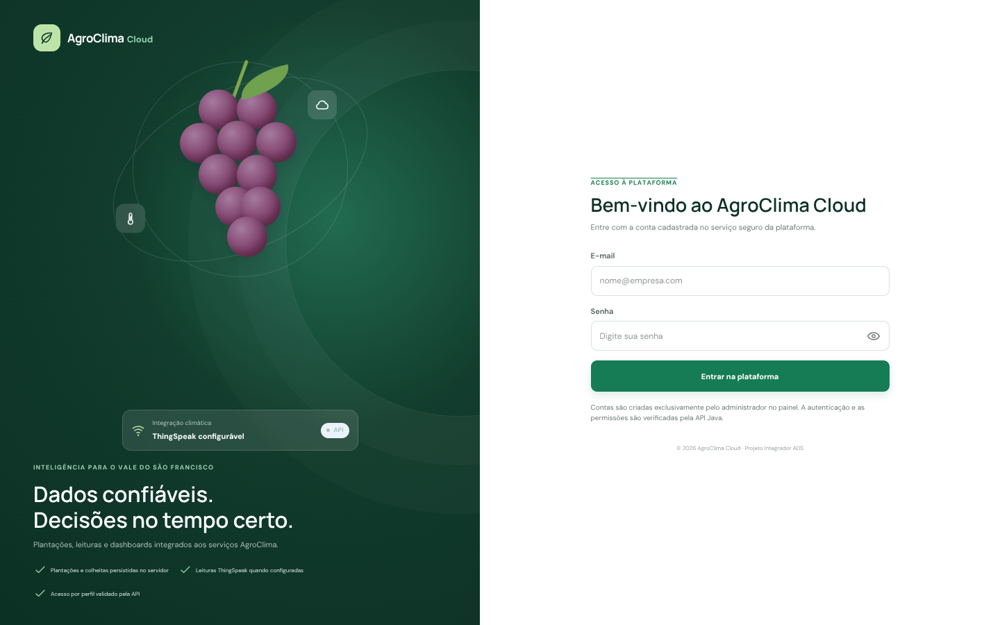
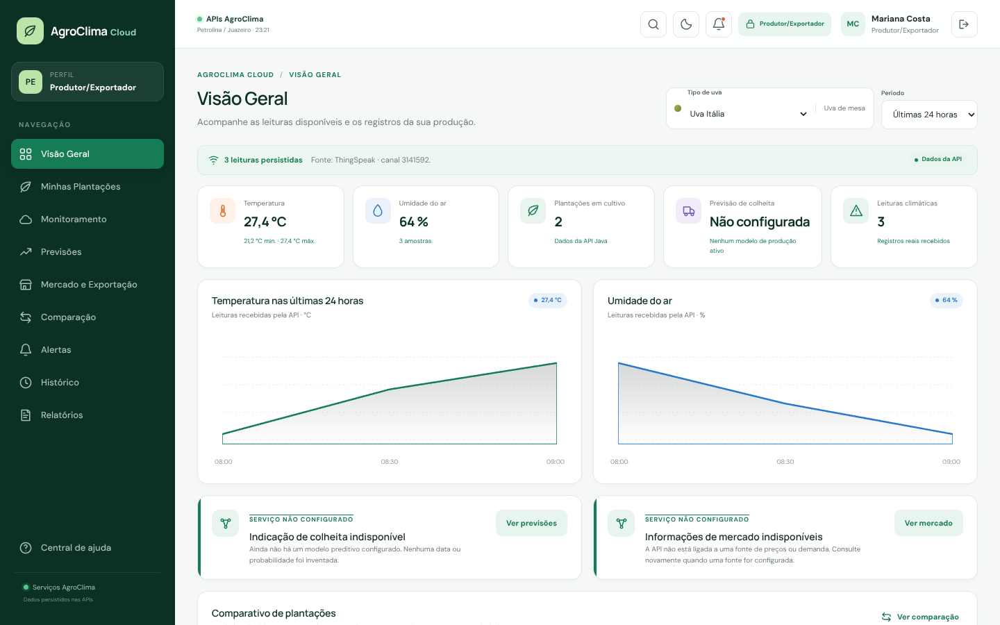
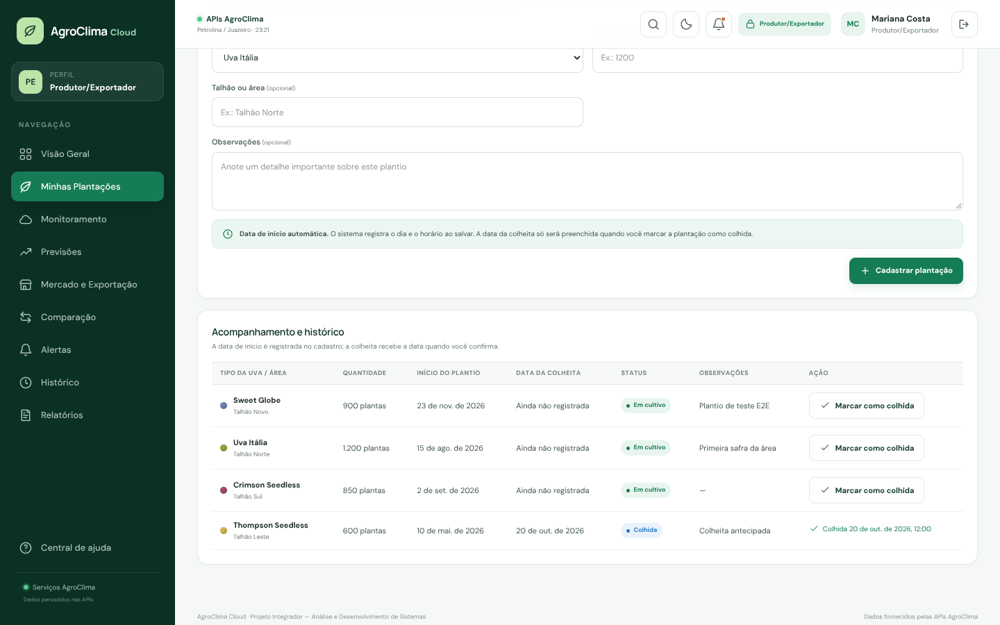
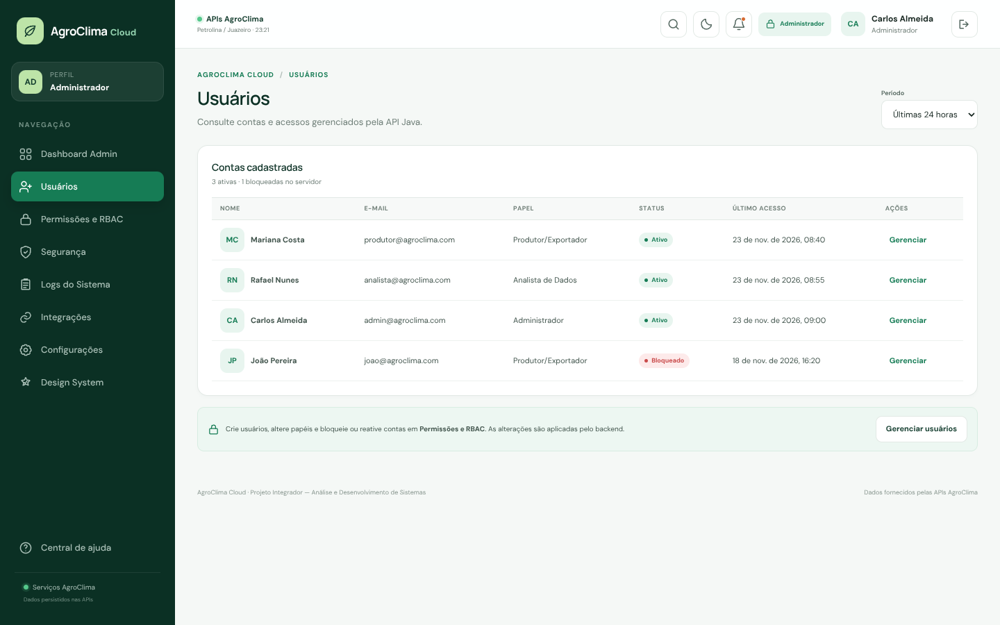
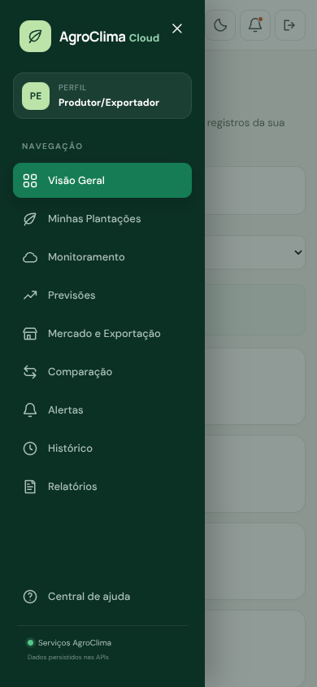
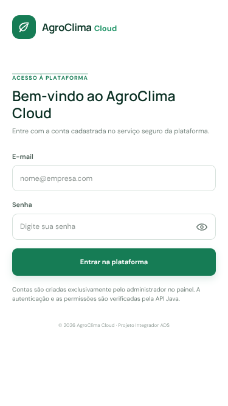

# Relatório de Testes End-to-End — AgroClima Cloud

**Projeto:** AgroClima Cloud — Projeto Integrador ADS  
**Equipe:** Priscila Barbosa, Leticia Gabrielle, André Costa, Caio Victor, Luciana Borges e Camila Pessoa  
**Ferramenta:** Cypress + Google Chrome  
**Data de execução:** 23/11/2026  
**Versão:** 1.0  
**Documento formal (Word):** [`relatorio-apresentacao-cypress.docx`](./relatorio-apresentacao-cypress.docx)  
**Versão para impressão (PDF):** [`relatorio-apresentacao-cypress.pdf`](./relatorio-apresentacao-cypress.pdf)  
**Relatório técnico completo:** [`relatorio-testes-cypress.md`](./relatorio-testes-cypress.md)

---

## Resultado em destaque

| Casos executados | Taxa de aprovação | Defeitos altos em aberto |
|---:|---:|---:|
| **71** | **100%** | **0** |

A suíte cobre autenticação, RBAC, fluxos dos três perfis, integração com as APIs, usabilidade, responsividade e regressão.

---

## 1. Objetivo

Validar, por meio de testes End-to-End automatizados em Cypress, se o frontend do AgroClima Cloud se comporta conforme as regras de negócio e os contratos das APIs. Os testes abrem a aplicação no navegador, autenticam usuários, navegam pelas áreas permitidas, preenchem formulários, disparam requisições e conferem o resultado na tela.

## 2. Escopo

### Coberto

- Login institucional, validação de campos, credenciais inválidas, sessão e logout.
- RBAC por perfil: menu, páginas e deep links para Produtor, Analista e Administrador.
- Plantações, previsões, mercado, comparação, alertas, histórico e relatórios CSV.
- Dashboards, qualidade dos dados, modelos preditivos, usuários, RBAC, auditoria, integrações, configurações e Design System.
- Contratos camelCase, Bearer token, respostas 401/403/500 e falha de rede.
- Acessibilidade básica, tema claro/escuro, desktop, mobile e tabelas com rolagem.
- Tempo de carregamento, feedback de carregamento, console e preservação de sessão.

### Fora do escopo

Testes de carga acima de 50.000 usuários, migração de dados legados, navegadores obsoletos, testes nativos em Safari/iOS e infraestrutura de produção. O backend não é inicializado durante a suíte; as respostas são controladas por stubs com os contratos reais.

## 3. Estratégia e ambiente

| Item | Configuração |
|---|---|
| Framework | Cypress, com sete specs em `cypress/e2e` |
| Navegador | Google Chrome, headless e interativo |
| Aplicação | Vite 7.3.7 em `http://localhost:5173` |
| APIs | Java em `:8080` e Python em `:8000`, simuladas com `cy.intercept` |
| Massa | `cypress/fixtures/api.json` — três perfis e todos os recursos |
| Resolução | 1440 × 900 (desktop) e 390 × 844 (mobile) |
| Isolamento | Armazenamento limpo, sessão própria e rotas reiniciadas por teste |
| Evidências | Captura automática em falha + sete capturas dos fluxos principais |

### Organização da suíte

| Suíte | Casos |
|---|---:|
| 01 · Autenticação e Controle de Acesso | 15 |
| 02 · Funcionalidades do Produtor/Exportador | 10 |
| 03 · Funcionalidades do Analista de Dados | 8 |
| 04 · Funcionalidades do Administrador | 11 |
| 05 · Integração Frontend ↔ APIs | 8 |
| 06 · Usabilidade, Responsividade e Acessibilidade | 11 |
| 07 · Não Funcional e Regressão | 8 |
| **Total** | **71** |

### Nota de transparência

A suíte foi escrita para o Cypress. No ambiente de validação inicial, o binário oficial não pôde ser baixado porque o CDN do Cypress estava bloqueado; os mesmos arquivos `.cy.js`, stubs e fixture foram executados em Chromium headless por um runner de compatibilidade. Em uma máquina com acesso ao CDN, a execução oficial é feita com `npm run test:e2e:ci`.

## 4. Resultados

| Suíte | Casos | Aprovados | Falhas | Taxa |
|---|---:|---:|---:|---:|
| 01 · Autenticação e Controle de Acesso | 15 | 15 | 0 | 100% |
| 02 · Funcionalidades do Produtor/Exportador | 10 | 10 | 0 | 100% |
| 03 · Funcionalidades do Analista de Dados | 8 | 8 | 0 | 100% |
| 04 · Funcionalidades do Administrador | 11 | 11 | 0 | 100% |
| 05 · Integração Frontend ↔ APIs | 8 | 8 | 0 | 100% |
| 06 · Usabilidade, Responsividade e Acessibilidade | 11 | 11 | 0 | 100% |
| 07 · Não Funcional e Regressão | 8 | 8 | 0 | 100% |
| **Total** | **71** | **71** | **0** | **100%** |

**Distribuição por severidade:** Alta 36 · Média 32 · Baixa 3.  
**Casos de severidade Alta:** 36/36 aprovados.  
**Tempo de execução:** aproximadamente 2 min 21 s.  
**Testes de unidade:** 73/73 aprovados (complementares).

## 5. Evidências

### Login institucional



### Visão Geral do produtor



### Cadastro de plantação



### Usuários no painel do administrador



### Responsividade mobile

 

## 6. Roteiro para a apresentação

Demonstração sugerida: **administrador cadastrando um usuário com perfil Analista**.

| Passo | Ação | Resultado esperado |
|---:|---|---|
| 1 | Abrir `http://localhost:5173` | Tela de login, sem autocadastro |
| 2 | Entrar como `admin@agroclima.com` / `admin123` | Dashboard Admin e menu administrativo |
| 3 | Abrir **Permissões e RBAC** | Formulário “Criar conta de usuário” |
| 4 | Preencher nome, e-mail, senha, telefone e papel **Analista** | Máscara aplicada e envio para a API |
| 5 | Conferir mensagem e tabela | “Conta ... criada no servidor”; linha com status Ativo |
| 6 | Sair e entrar com o novo analista | Dashboard Analítico; sem Usuários nem RBAC |

### Plano B

- **API indisponível:** executar a suíte com a massa mockada e apresentar as capturas.
- **Cypress bloqueado:** apresentar as evidências e o relatório técnico.
- **Interface divergente:** usar a captura `03-cadastro-plantacao.png` e o relatório.
- **Imprevisto:** não alterar o código durante a apresentação; registrar a mensagem e seguir.

## 7. Defeitos e observações

### DEF-01 — `aria-pressed` vazio no botão de tema (corrigido)

| Campo | Conteúdo |
|---|---|
| Severidade | Média — acessibilidade / UI |
| Caso | CT-06.3 |
| Esperado | `aria-pressed="false"` no tema claro e `"true"` no escuro |
| Obtido | `aria-pressed=""` porque o helper `html` descartava `false` |
| Correção | `frontend/js/views/shell-view.js`: valor convertido para string |
| Reteste | CT-06.3 aprovado |

### OBS-01 — Indicador do topo em erro de página (aberto, baixa)

Em erro 500 de dados, o aviso `.api-notice.error` aparece corretamente, mas o texto do topo só é atualizado em uma nova renderização do shell. O CT-05.4 valida o requisito principal: aviso visível, shell e sessão preservados. Melhoria de baixa severidade, sem impacto no fluxo principal.

## 8. Critérios de aceitação

| Critério do Plano de Testes | Resultado | Situação |
|---|---|---|
| 100% dos casos de alta prioridade aprovados | 36/36 | Atendido |
| Nenhum defeito Bloqueante ou Alta em aberto | Nenhum | Atendido |
| Taxa mínima de 95% | 100% (71/71) | Atendido |
| Relatório assinado e aprovado | Este documento | Pendente de assinatura |

## 9. Conclusão

A suíte cumpriu o escopo do Plano de Testes e obteve **100% de aprovação**. Os fluxos críticos de autenticação, autorização por perfil, plantações, relatórios, modelos, administração e integração com as APIs apresentaram o comportamento esperado. O defeito de acessibilidade foi corrigido e retestado. O sistema está apto para a demonstração, e a suíte pode ser incorporada ao pipeline de CI para evitar regressões.

## Anexo — como reproduzir

```bash
cd frontend
npm install
npm run test:e2e:ci
```

Somente um arquivo, no Chrome:

```bash
npx cypress run --browser chrome --spec "cypress/e2e/adminCadastraAnalista.cy.js"
```

A matriz completa dos 71 casos, com tipo, severidade e resultado, está no Anexo A do DOCX e no [relatório técnico](./relatorio-testes-cypress.md).
